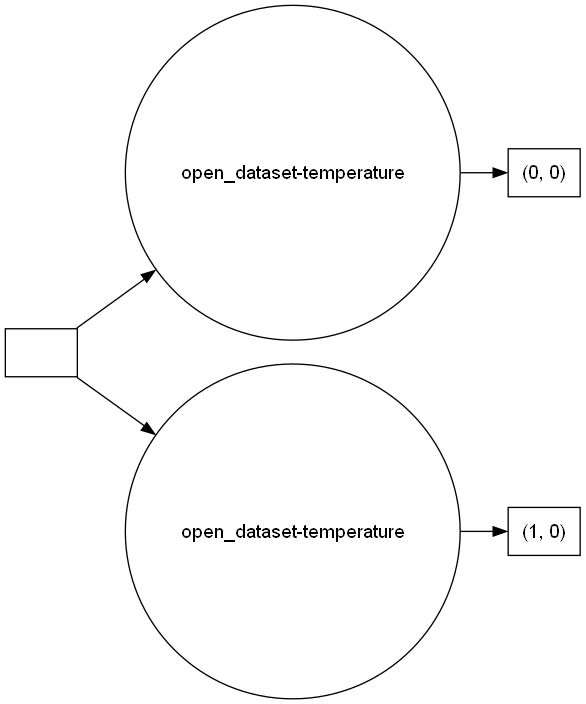
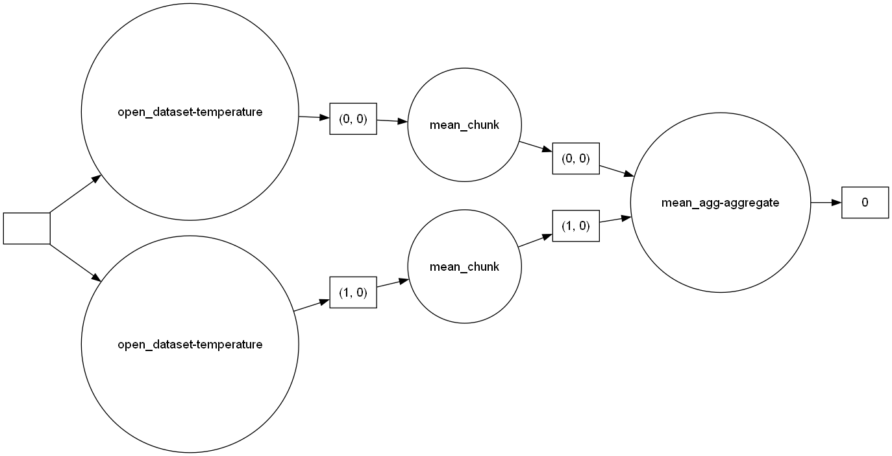

# The task graph
The centrepiece of any dask computation is the task graph. Dask breaks up the computation into individual tasks and produces a dependency graph. 

## A simple example
Let's have a look at this example script (``scripts/visualize_temperature_mean_task_graph.py``).

```python
"""Visualise the task graph for computing the mean temperature before running it."""

from pathlib import Path

import xarray as xr

DATASET_PATH = Path(__file__).resolve().parent.parent / "datasets" / "example_temperature.nc"
FIGURE_DIR = Path(__file__).resolve().parent.parent / "figures" 

def main() -> None:
    FIGURE_DIR.mkdir(exist_ok=True)

    # open the dataset
    ds = xr.open_dataset(DATASET_PATH, chunks={})
    print(ds)
    ds["temperature"].data.visualize(filename=str(FIGURE_DIR / "temperature_dataset_task_graph.png"), rankdir="LR")

    # compute the mean temperature
    mean_temperature = ds["temperature"].mean(dim="time")   
    mean_temperature.data.visualize(filename=str(FIGURE_DIR / "temperature_mean_task_graph.png"), rankdir="LR")

    # compute the mean temperature and print the result
    print(mean_temperature.compute())


if __name__ == "__main__":
    main()
```

It's a very simple script that opens a netcdf as an xarray dataset and then computes the time mean of the temperature. By explicitly passing a dict, even an empty one, to the ``chunks`` keyword we tell xarray to use dask when opening the dataset. 

### Loading data
Examining the output from printing the dataset shows that we have a single variable ``temperature`` with coordinates ``time`` and ``latitude``.
```plain
<xarray.Dataset> Size: 4kB
Dimensions:      (time: 20, latitude: 20)
Coordinates:
  * time         (time) datetime64[ns] 160B 2026-01-01 2026-01-02 ... 2026-01-20
  * latitude     (latitude) float64 160B -45.0 -40.26 -35.53 ... 40.26 45.0
Data variables:
    temperature  (time, latitude) float64 3kB dask.array<chunksize=(10, 20), meta=np.ndarray>
```
Crucially, ``temperature`` is a dask array with chunksize ``(10,20)``. The total size of the array is ``(20,20)`` so the array is divided into two chunks. If we inspect the task graph for the underlying dask array we see two ``open_dataset-temperature`` items, one per chunk. At this point no data has been loaded. Dask has just included a task to load the data in the task graph.




### Computing the mean
Now let's see what happens when we add a call to compute the time mean. 



Dask breaks this up into first computing the mean over each chunk and then aggregrating the two means. Each chunk mean only has a single dependency, loading the relevant chunk. Crucially, the chunk mean is independent of whatever the other chunk is doing. 

Imagine this was not a small example but that each chunk was in fact many gigabytes such that only one chunk fits in memory at a time. If we tried to load the whole dataset at once and compute the mean we would run out of memory. But with dask we can do the top branch first and only keep the result of the chunk mean in memory. Then we can do the bottom branch, collect that result, and then do the aggregration. In this way we compute the mean without ever requiring the full dataset in memory. Decisions about the order in which the tasks in the task graph get executed are the progative of the scheduler, which the subject of the [next document](03-schedulers.md).

### Actually running the computation
To actually do the computation we call the ``compute()`` method. This forces the executation of the task graph. Inspecting the output, we see exactly what expect a 1D array of mean temperature values as a function of latitude.
```plain
<xarray.DataArray 'temperature' (latitude: 20)> Size: 160B
array([24.        , 23.05263158, 22.10526316, 21.15789474, 20.21052632,
       19.26315789, 18.31578947, 17.36842105, 16.42105263, 15.47368421,
       14.52631579, 13.57894737, 12.63157895, 11.68421053, 10.73684211,
        9.78947368,  8.84210526,  7.89473684,  6.94736842,  6.        ])
Coordinates:
  * latitude  (latitude) float64 160B -45.0 -40.26 -35.53 ... 35.53 40.26 45.0
Attributes:
    units:    degC
```
